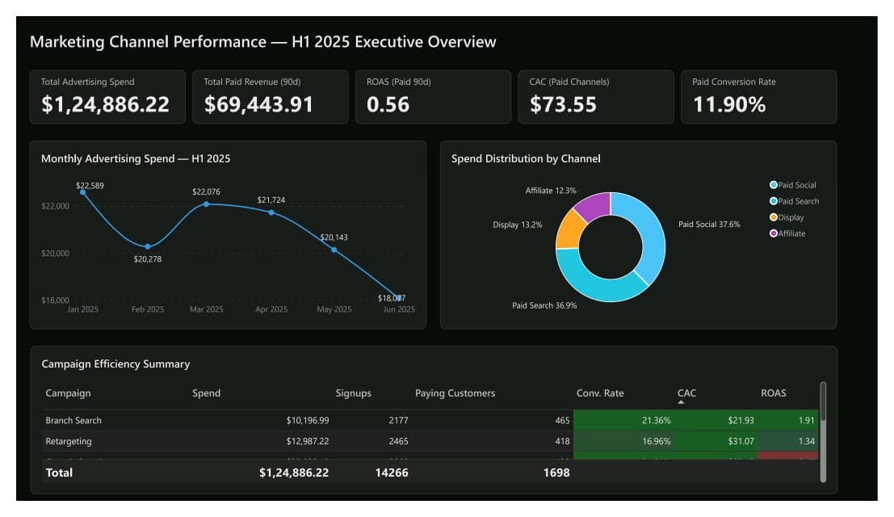
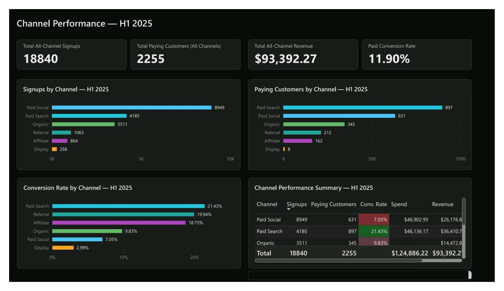
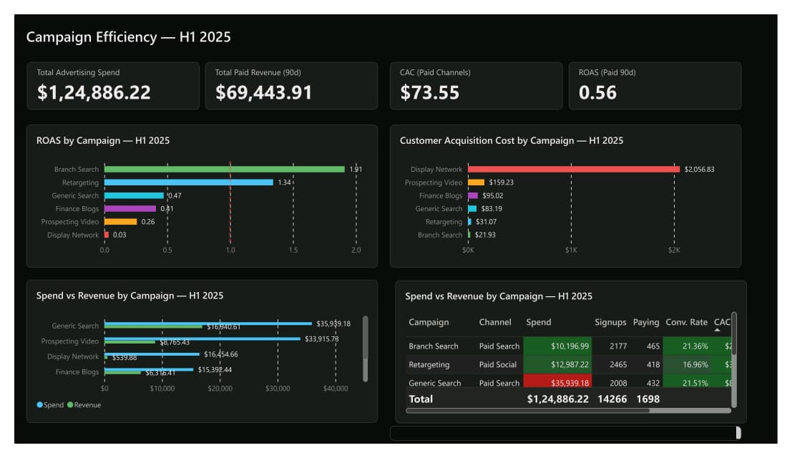
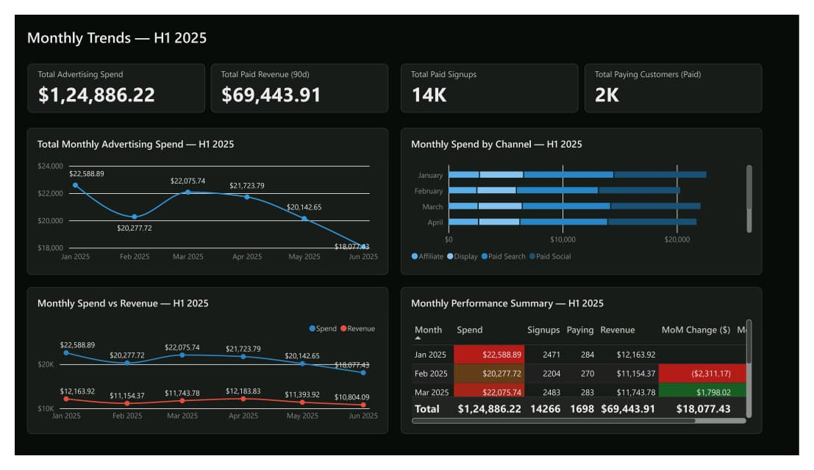

# Marketing Channel Performance Analytics
### Robinhood Growth Team — H1 2025 Ad Spend vs Signup & Revenue Analysis

> **Stack:** SQL (MySQL 8) · Microsoft Excel · Microsoft Power BI Desktop · Git / GitHub

---

## Business Problem

Robinhood lets users open a free account and optionally upgrade to **Robinhood Gold** (a paid subscription).  
The CMO is setting the H2 2025 marketing budget and needs to know:

> *"Which channels and campaigns are actually worth the money — measured not just by signups, but by paying subscribers and 90-day revenue?"*

Six months of daily ad-spend data (Jan–Jun 2025) is joined to an 18,840-row signup table that tracks whether each user ever became a paying subscriber and how much revenue they generated in their first 90 days.

---

## Objectives & Business Questions

| # | Question |
|---|----------|
| 1 | Which channels produce the most signups? The most paying customers? |
| 2 | What does it cost to acquire a signup vs a paying subscriber per channel? |
| 3 | Which channels have the strongest signup-to-subscriber conversion rates? |
| 4 | Which campaigns deliver the best return on ad spend (ROAS)? |
| 5 | How did campaign performance change month-over-month? |
| 6 | Which campaigns consumed budget without producing comparable outcomes? |
| 7 | How do paid channels compare to organic and referral on conversion quality? |
| 8 | Where should H2 2025 budget be reallocated? |

---

## Technology Stack

| Layer | Tool | Purpose |
|-------|------|---------|
| Database | MySQL 8.0 | Data loading, cleaning, transformations, analytics |
| Spreadsheet | Microsoft Excel | Data profiling, validation, independent KPI checks |
| Visualisation | Power BI Desktop | Semantic model, DAX measures, interactive dashboard |
| Version Control | Git / GitHub | Reproducibility, portfolio presentation |

---

## Datasets

| File | Rows | Columns | Description |
|------|------|---------|-------------|
| `ad_spend.csv` | 1,046 (1,039 after dedup) | 6 | Daily impressions, clicks, spend per campaign (Jan–Jun 2025) |
| `signups.csv` | 18,840 | 7 | One row per user — channel, campaign, subscription status, 90-day revenue |

**Source:** [Data Career School — Marketing Channel Performance Lab](https://www.datacareerschool.com/datalabs/marketing-channel-performance)  
Data is synthetic and provided for educational purposes.

**Key data note:** Channel names differ between files.  
`ad_spend.csv` uses title-case (e.g. `Paid Search`); `signups.csv` uses snake_case (e.g. `paid_search`).  
A `channel_key` column normalises both to snake_case before joining.

---

## Data Model

```
dim_date ──────────────────────────────────────────┐
dim_channel ───────────────────────────────────────┤
dim_campaign ──────────────────────────────────────┤
                                                    ▼
fact_ad_spend (date, channel_key, campaign, impressions, clicks, spend)
        ▲
        │  JOIN on channel_key + campaign + month
        ▼
fact_signups (user_id, signup_date, channel, campaign, is_paid, revenue_90d)
```

---

## SQL Analysis Approach

Six numbered scripts implement a reproducible pipeline:

| Script | Purpose |
|--------|---------|
| `01_database_setup.sql` | Create database and user |
| `02_table_creation.sql` | DDL for raw and staging tables |
| `03_data_quality_checks.sql` | Nulls, duplicates, date gaps, channel mismatches |
| `04_transformations.sql` | Dedup, channel_key normalisation, staging views |
| `05_business_analysis.sql` | All KPI queries with inline interpretations |
| `06_validation_queries.sql` | Cross-check totals against Excel |

---

## Key KPI Definitions

| KPI | Formula | Notes |
|-----|---------|-------|
| Cost per Signup (CPS) | Total Spend ÷ Total Signups | Paid campaigns only |
| Customer Acquisition Cost (CAC) | Total Spend ÷ Paying Customers | Subscription conversions only |
| Conversion Rate (CVR) | Paying Customers ÷ Total Signups | Per channel or campaign |
| CTR | Total Clicks ÷ Total Impressions | Ad efficiency metric |
| CPC | Total Spend ÷ Total Clicks | Media buying efficiency |
| ROAS | 90-day Revenue ÷ Total Spend | First-90-day window; not full LTV |

> **ROAS limitation:** Revenue is capped at the subscriber's first 90 days. True ROAS over the customer's lifetime will be higher. Use this metric for relative ranking, not absolute profitability.

---

## Power BI Dashboard

The report spans four pages. Screenshots are from the published `.pbix` file.

### Page 1 — Executive Overview

Top-line KPI scorecards, monthly spend trend, spend distribution by channel, and a campaign efficiency summary table sorted by CAC.



### Page 2 — Channel Performance

All-channel signup and paying-customer volume, conversion rate by channel (bar), and a channel performance summary table including unpaid channels for benchmarking.



### Page 3 — Campaign Efficiency

ROAS and CAC ranked bar charts, spend vs revenue comparison, and a full campaign detail table with conditional formatting — green for high conversion, red for low.



### Page 4 — Monthly Trends

Month-over-month spend, revenue, signups, and paying-customer trends. Monthly spend-by-channel stacked bars and a performance summary table with MoM change column.



---

## Verified Findings (H1 2025)

| Metric | Value |
|--------|-------|
| Total ad spend (deduped) | **$124,886** |
| Total paid signups | 14,266 |
| Total paying customers (paid channels) | 1,698 |
| Overall paid conversion rate | 11.9% |
| Total 90-day revenue (all channels) | $93,392 |

### Campaign ranking by CAC (ascending = better)

| Campaign | Channel | Spend | Paying Customers | CAC | ROAS |
|----------|---------|------:|----------------:|----:|-----:|
| brand_search | Paid Search | $10,197 | 465 | **$21.93** | 1.91 |
| retargeting | Paid Social | $12,987 | 418 | **$31.07** | 1.34 |
| generic_search | Paid Search | $35,939 | 432 | $83.19 | 0.47 |
| finance_blogs | Affiliate | $15,392 | 162 | $95.02 | 0.41 |
| prospecting_video | Paid Social | $33,916 | 213 | $159.23 | 0.26 |
| display_network | Display | $16,455 | 8 | **$2,056.83** | 0.03 |

### Key insight: cheapest signup ≠ cheapest paying customer

- `prospecting_video` has the **2nd lowest cost per signup ($5.23)** but the **highest CAC ($159.23)** — it attracts browsers, not buyers.
- `brand_search` has a **$4.68 cost per signup AND the lowest CAC ($21.93)** — uniquely efficient at both stages.
- `display_network` stopped running after **2025-05-14** (134 of 181 campaign days) and produced only 8 paying customers from $16K in spend.

### Unpaid channel benchmark

| Channel | Signups | CVR | Revenue |
|---------|---------|----:|--------:|
| Referral | 1,063 | **19.9%** | $9,476 |
| Organic | 3,511 | 9.8% | $14,473 |

Referral converts at nearly the same rate as the best paid campaign at zero media cost.

### H2 Budget Recommendation

| Channel | Current Share | Recommended | Rationale |
|---------|:-------------:|:-----------:|-----------|
| Paid Search – brand | 8% | **↑ 18%** | Lowest CAC, ROAS > 1.9 |
| Paid Social – retargeting | 10% | **↑ 20%** | Second-best CAC, ROAS > 1.3 |
| Paid Search – generic | 29% | **→ 25%** | Decent volume; moderate efficiency |
| Affiliate – finance_blogs | 12% | **→ 12%** | Acceptable CAC; steady performance |
| Paid Social – prospecting | 27% | **↓ 20%** | High volume, poor conversion quality |
| Display – display_network | 13% | **↓ 5%** | Near-zero conversion; campaign ended |

**Risks:** Brand search budgets face diminishing returns if brand awareness is already high. Cutting prospecting too aggressively may shrink the top of the funnel that retargeting relies on.

---

## How to Reproduce

```bash
# 1. Clone the repo
git clone https://github.com/<your-username>/marketing-channel-performance.git
cd marketing-channel-performance

# 2. Load data into MySQL
mysql -u root -p < sql/01_database_setup.sql
mysql -u root -p marketing_analytics < sql/02_table_creation.sql
# Import CSVs via MySQL Workbench Table Data Import Wizard
# (see docs/methodology.md for full instructions)
mysql -u root -p marketing_analytics < sql/03_data_quality_checks.sql
mysql -u root -p marketing_analytics < sql/04_transformations.sql
mysql -u root -p marketing_analytics < sql/05_business_analysis.sql

# 3. Open Excel workbook
# excel/marketing_data_quality_and_validation.xlsx

# 4. Build Power BI report
# Follow power_bi/report_specification.md step by step
# Connect to MySQL using the views created in step 2
```

---

## Limitations & Future Work

- **ROAS is 90-day revenue only** — not full customer lifetime value.
- **Attribution is last-touch** — a user who saw a display ad, clicked a search ad, and signed up organically is credited entirely to organic.
- **No A/B test data** — performance differences may reflect audience targeting, not creative quality.
- **Future improvements:** cohort retention curves, LTV modelling, multi-touch attribution, A/B test significance testing.

---

## Project Structure

```
marketing-channel-performance/
├── README.md
├── .gitignore
├── LICENSE_OR_DATA_ATTRIBUTION.md
├── docs/
│   ├── business_problem.md
│   ├── data_dictionary.md
│   ├── methodology.md
│   ├── insights_and_recommendations.md
│   └── project_handover.md
├── data/
│   ├── raw/                          ← original CSVs (ad_spend.csv, signups.csv)
│   └── processed/                    ← cleaned exports from SQL (after MySQL run)
├── sql/
│   ├── 01_database_setup.sql
│   ├── 02_table_creation.sql
│   ├── 03_data_quality_checks.sql
│   ├── 04_transformations.sql        ← creates 8 MySQL views
│   ├── 05_business_analysis.sql      ← 10 business queries with results
│   └── 06_validation_queries.sql     ← 12 cross-checks (V1–V12)
├── excel/
│   └── marketing_data_quality_and_validation.xlsx   ← 8 sheets, CF rules, heatmap
│   └── excel_analysis/
│        └── Marketing_Channel_Performance_Analysis.xlsx
├── power_bi/
│   ├── dax_measures.md               ← 20+ DAX measures, full validation table
│   ├── model_specification.md        ← star schema, relationships, column renames
│   └── report_specification.md       ← 4-page spec, step-by-step build guide
└── outputs/
    ├── sql_results/                  ← 4 verified result CSVs (campaign, monthly, channel, detail)
    ├── validation/
    │   └── reconciliation_notes.md  ← 12-check reconciliation; 14 QA issues documented
    └── power_bi/
        ├── Marketing_Channel_Performance_Analytics.pbix
        ├── Executive_Overview.jpeg
        ├── Channel_Performance.jpeg
        ├── Campaign_Efficiency.jpeg
        └── Monthly_Trends.jpeg
```

---

*Project by Naveen Kumar K · Data Analyst Portfolio · Built on the Data Career School Marketing Channel Performance lab*
